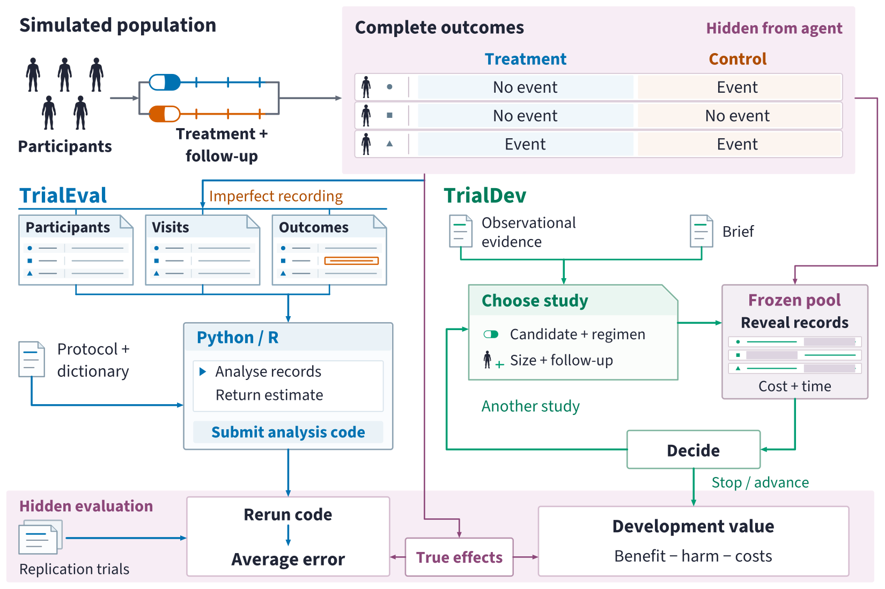
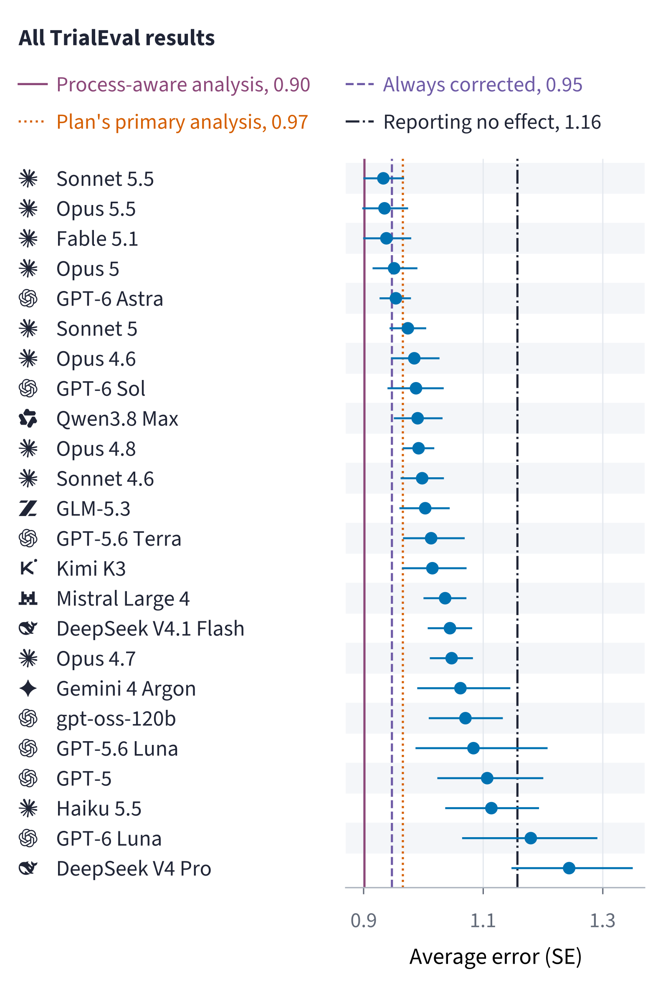
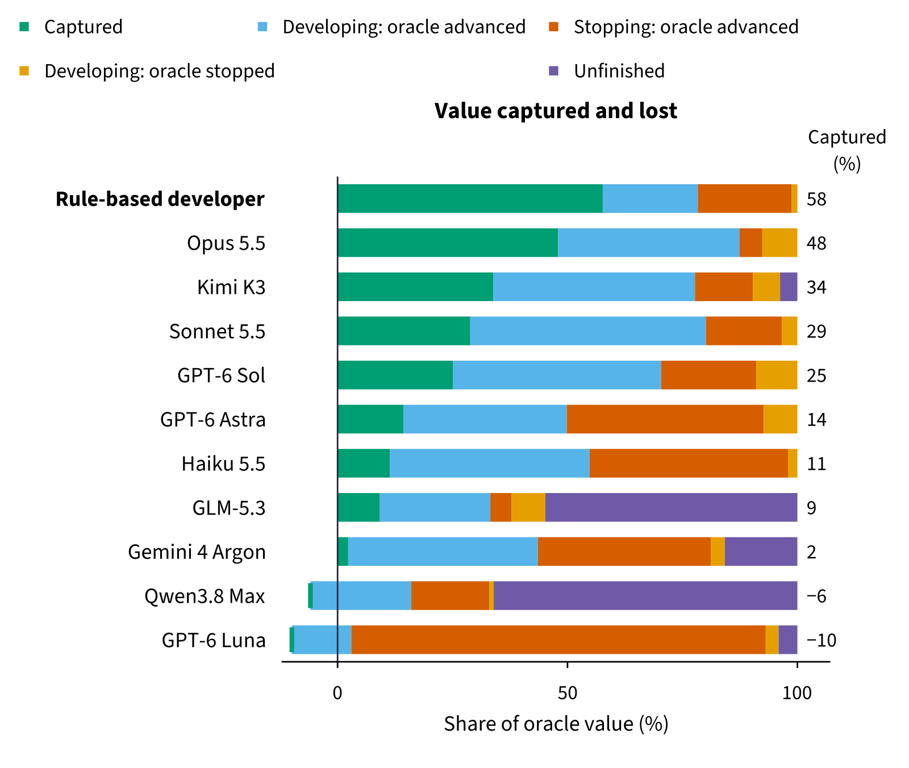
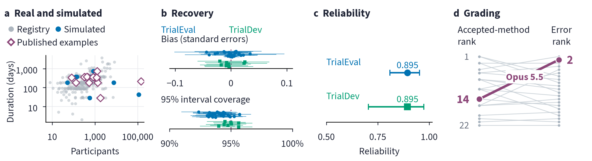

# TrialAgentBench

New medicines are one of the most tangible ways science serves people. The hope is that if we can make clinical trials faster, cheaper, and better, we can bring more medicines to more patients sooner, and that AI agents may be part of making that happen. Every step of the way there are decisions that need to trade off time and money for information, but there is no established way to evaluate agents on these decisions, because real trials are costly, involve people and never reveal the counterfactual.

TrialAgentBench is a benchmark for evaluating AI agents on clinical trial analysis and drug development decision-making, using simulated clinical trials with known true effects, embedded within the data records of a fictional drug sponsor.

- **TrialEval** gives agents the raw data records of a simulated clinical trial. We re-execute the analysis code they produce on fresh trials and measure how close the results are to the true effect, regardless of method.
- **TrialDev** gives agents a budget and a time limit to develop new drugs through a sequence of decisions, and we measure how much value their decisions achieve at the true effects.

The simulated clinical trials have the same types of variation as those in the real world:

- **Designs:** individually randomised and cluster-randomised trials, stepped-wedge rollouts with time trends, group-sequential trials that can stop early and non-inferiority trials, with 52 to 114,000 participants.
- **Questions:** 17 clinical questions, from safety in childbirth to metastatic cancer, on risks, event rates, time free of events and scores measured at irregular visits.
- **Conduct and records:** Participants drop out, miss visits, and change treatment. The records include versioned tables, unit errors, events logged late, and logging errors that may or may not bias a standard analysis.

- **Programmes:** on TrialDev, four diseases, 3 or 5 candidates, starting evidence with different amounts of confounding, and three budgets.

[We publicly release nearly 3,500 tasks](https://huggingface.co/datasets/BradSegal/TrialAgentBench), ranging from single clinical trial analysis to multi-phase drug development programmes with budget and time constraints. This repository contains the harness for running agents on the benchmark, the independent verifier for rescoring them, and documentation.

<p align="center">
  
  <br>
  <sub>TrialAgentBench overview. The simulator defines the true effects, but the agent only has access to the trial’s data records with recording errors.</sub>
</p>

## Results

Across 24 closed- and open-weight models, we find that the best agents can now analyse raw, messy clinical trial data records to within 6% of a process-aware analysis, even if an assumption is violated to mislead them. What limits them is decision-making from evidence under uncertainty: when to correct, what evidence to buy, when to stop. On TrialDev, the best agent captures 48% of the value an oracle would capture. This compares to 58% for a rule-based developer.

<p align="center">
  
  <br>
  <sub>Average error on TrialEval across all models with 95% intervals, compared to the baselines and to reporting no effect.</sub>
</p>

<p align="center">
  
  <br>
  <sub>Value captured and lost relative to an oracle on TrialDev, for each agent and the rule-based developer.</sub>
</p>

We validate the simulation against what we know about real clinical trials:

- **The true effect is recovered.** The process-aware analysis has bias within 0.05 standard errors, and its 95% intervals contain the true effect 92–96% of the time.
- **The trials resemble real trials.** Their size and conduct fall within, or close to, the range of held-out registry and published trials.
- **Effect sizes are realistic.** 25.5% of z-statistics are beyond 1.96, against 26.2% expected from Cochrane reviews.
- **The analysis code is independently reproducible.** The scored estimators agree with an independent R implementation on generated datasets, and the analysis code matches an independent calculation on real randomised trials.
- **Scores are reliable.** We score each model on two random halves of tasks and find similar rankings. The split-half reliability, adjusted for the full set of tasks, is 0.89 for both suites (1 is a perfect match).

<p align="center">
  
  <br>
  <sub>Validation of the simulated trials and scores. See the paper for details.</sub>
</p>

## Quickstart

Requires Python 3.11 or 3.12 and [uv](https://docs.astral.sh/uv/) installed. Docker must be running.

```bash
git clone --branch v1.1.0 https://github.com/BradSegal/TrialAgentBench
cd TrialAgentBench
uv sync --locked
docker build --tag trialagentbench/executor:1.0.1 executor
uv run trialagentbench demo run --output results/demo
```

The demo runs a scripted analyst in about a minute once the image is built. No API key or download is required, and the demo does not score any model. Open `results/demo/index.html`.

## Documentation

| Document | Purpose |
| --- | --- |
| [Running](docs/RUNNING.md) | Install, download, run a model, read the results |
| [Methods](docs/METHODS.md) | Clinical questions, the choices an agent has, scoring |
| [Verifier](verifier/README.md) | Verify a download and re-score a campaign without the harness |
| [Examples](examples/README.md) | Configurations, a scripted walkthrough, your own agent, the rule-based developer |

## Citation and licence

```bibtex
@inproceedings{segal2026trialagentbench,
  author    = {Segal, Bradley and Bolton, William and Torr, Philip and Clifton, David and Clifton, Lei},
  title     = {TrialAgentBench: Evaluating AI Agents for Clinical-Trial Analysis and Long-Horizon Drug-Development Decisions},
  booktitle = {Advances in Neural Information Processing Systems (NeurIPS), Evaluations and Datasets Track},
  year      = {2026},
  url       = {https://github.com/BradSegal/TrialAgentBench}
}
```

Code is licensed under [Apache-2.0](LICENSE). Data and documentation are licensed under CC BY 4.0. TrialAgentBench is a simulation-based benchmark for evaluating AI agents and should not be used for clinical decision-making.
